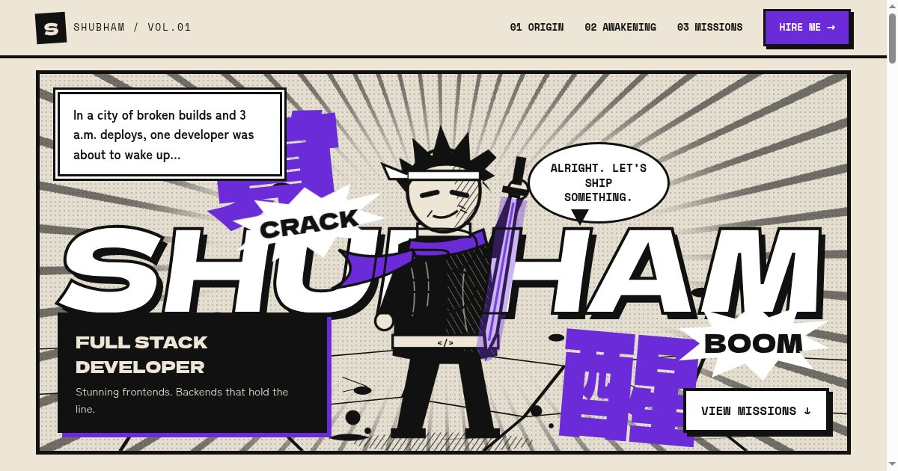

# Shubham — Vol. 01

A portfolio told as a manga volume: a sticky cover with a layered hero, then four chapters (Origin, Awakening, Missions, Finale) plus a case-file page for every project.



**Live:** https://portfolio-shubham-seven.vercel.app/

## Stack

- **Next.js 16** (App Router). Every route is statically generated. The only client component is the small `ScrollFx` effects script.
- **Tailwind CSS 4.** Design tokens live in `@theme`; the manga primitives are plain CSS.
- **CSS-first motion.** Scroll-driven animations (`animation-timeline: view()`) do the work in Chromium. One small client script, `components/fx/ScrollFx.tsx`, drives the same effects from scroll position in browsers without scroll timelines (Firefox, older Safari). `prefers-reduced-motion` turns all of it off.
- **Fonts:** Dela Gothic One and Zen Kaku Gothic New, self-hosted as glyph subsets (about 42 KB in total). Space Mono comes from `next/font/google`.
- **Tests:** Jest with React Testing Library.

## Getting started

```bash
npm install
npm run dev        # http://localhost:3000
npm run build      # static production build
npm run lint       # eslint
npm run typecheck  # tsc --noEmit
npm test           # jest
```

## Project structure

```
app/
  layout.tsx               fonts, metadata, header, shared SVG defs
  page.tsx                 home: cover + chapters
  missions/[slug]/page.tsx case file per project (SSG)
  not-found.tsx            manga 404
  globals.css              Tailwind import, design tokens, base styles
  styles/manga.css         manga primitives, keyframes, scroll timelines, mobile rules
  fonts/                   subset WOFF2 files (generated)
components/
  manga/                   design system: Hero (character + poses), Panel, Bubble, Caption,
                           Burst, Sfx, SpeedLines, Ruins, CharacterPanel, PageTurn, ChapterHeading, buttons
  layout/SiteHeader.tsx
  sections/                Cover, Origin, Awakening, Missions, Finale
  missions/                MissionFeature, MissionCard, MissionShot
lib/
  types.ts                 content types
  content.ts               typed accessors over data/portfolio.json
data/portfolio.json        all copy and content
scripts/subset-fonts.mjs   regenerates app/fonts
```

## Reading effects

- **Pinned pages (desktop):** chapters that fit on one screen (Origin, Finale) stay in place while their panels appear one at a time. To pin a section, give it `pin-track` with a `--n` step count, wrap its content in `pin-stage`, and give each `Panel`/`CharacterPanel` a `step={i}`. Pinning is off below 1024×740 and with reduced motion.
- **Page curl:** `PageTurn` peels the previous page away as you scroll.
- **Typewriter + shake:** `Bubble` text types out when its panel lands. `Burst` and `Sfx` shake their section once.
- **Page counter, brush cursor, halftone screenshots** (colour returns on hover). Speed lines stand still on phones.

Effect styles live in `app/styles/fx.css`.

## Day / Night editions

The site ships two editions of the volume. **Night** (black paper, bone ink, blood-red accent) is the default. The **☀ DAY EDITION** button switches to the original paper look, and the choice is remembered in `localStorage` under `mode`.

- **Colours are role tokens** (`paper`, `sheet`, `ink`, `line`, `fg`, `fg-inv`, `accent`, `shadow`, `letter-*`) in `app/globals.css`. `app/styles/night.css` remaps them under `html.night` and adds the night-only pieces: the moon, the slashes, the character glow and the red eyes. Use the tokens instead of hex values so new components follow both editions.
- **Copy that differs** lives in `data/portfolio.json` → `editions.day` / `editions.night`. Render it with `<Ed k="…" />`, or pass `night` to `Bubble` / `nightBubble` to `CharacterPanel`. Both versions are in the HTML; CSS shows the active one.
- A one-line script in `<head>` applies a saved Day choice before first paint, so the wrong theme never flashes.
- Switching plays a ~2s cinematic transition (`app/styles/cine.css`): letterbox bars, a moon or sun, a slash, and a title. The title comes from `editions.*.cineWord` / `cineSub`. The edition flips at 1s with a page shake. With reduced motion it switches instantly.

## Editing content

All text lives in `data/portfolio.json`:

- `contact.formspreeId`: the Formspree form the finale's contact form posts to (`https://formspree.io/f/<id>`). It has a hidden honeypot field (`_gotcha`) against spam.
- `personal.email`: when set, an **EMAIL** link appears next to GitHub and LinkedIn under the form.
- `personal.yearsExp`: shown as `EXP` on the Status panel. While it is empty, that line is hidden.
- `skills`: the 8 technique cards. `level` (0–100) sets the bar.
- `projects`: the first project is the featured S-rank mission. `enemy` (the problem) and `victory` (what shipped) fill the story-arc panels on its case file. Each project gets `/missions/<slug>`. Screenshots go in `public/projects/<slug>/`.

## Adding a page

Build new pages from the `components/manga` kit so they match the rest of the site. For example: `PageTurn`, then a section with `ChapterHeading`, then `Panel`s in a `g8` grid, with a `CharacterPanel` in whichever pose fits.

## Fonts

The Japanese-capable fonts are cut down to the characters the site actually uses. **If you add new kana/kanji or unusual symbols, run:**

```bash
npm run fonts
```

The script scans `app/`, `components/`, `data/` and `lib/` and downloads fresh subsets from Google Fonts.
